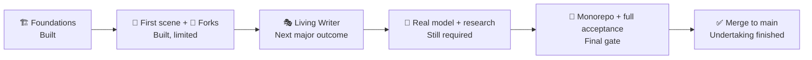

# Storyteller Workshop | The big picture

**The supervisor's first page.** This is the plain-language, visual status of the *entire* Storyteller evolution **and** Modular Monolith reshaping. Start here, not with the Change queue. The [Undertaking ledger](UNDERTAKING.md#whole-undertaking-completion-control--living-ledger) records technical evidence; [Program](PROGRAM.md) routes implementation.

**Checked:** 2026-11-21 · **Integration branch:** `undertaking/storyteller-workshop` · **Truth boundary:** integrated on this branch is not merged to `main`. This is a snapshot, **not live monitoring**. Next ChatGPT visit should compare it with the current HEAD and receipts.

## 🎯 What are we trying to finish?

You can invent a premise in one sentence, enter an ongoing fictional life, make meaningful decisions, work or wait, return later, and meet a Writer that **remembers what actually happened**. You can revisit or fork an old scene without inheriting the parent's future.

Underneath, one understandable modular monolith owns the game's truth. Not an ever-growing `application` junk drawer, a second clock, or a collection of fragile prompt scripts.

## At a glance

| Big outcome | State | What this means to a player or maintainer |
| --- | --- | --- |
| 🏗️ **Reshape the monorepo's foundation** | **Mostly built** | Story Engine and Admin have real owners; remaining compatibility forwarding and dependency cleanup are still due |
| 📚 **Remember stories and preserve scene history** | **Built on undertaking** | Library, Writer Workdesk and immutable scene-v2 publication exist |
| 🌿 **Revisit and fork an earlier life** | **Built on undertaking** | WR06 restores active historical commitments into a separate branch; still needs final end-to-end experience proof |
| 🚪 **Start from one prompt** | **Scripted core built** | WR07B saves an authenticated, readable first scene with safe retry; public Launch remains gated, real model mode unproved |
| 🎭 **Make a real choice and live through the next scene** | **Not yet built** | Writer-generated choice buttons are not yet executable; the continuing Living Writer must produce scene 2, scene 3 and beyond |
| 🧠 **Use a real model with bounded research and spending** | **Incomplete / proof outstanding** | Writer tools/custody foundations exist; a working funded provider route and optional independent read-only researchers remain to be demonstrated |
| 🧹 **Finish and land the whole undertaking** | **Not yet** | One bulk monorepo cleanup, long-life gameplay/failure acceptance, truthful docs, merge to `main` and retirement |

### The journey, visually

**Human interpretation:** we've completed much of the *engineering foundation*, **not** most of the playable experience. Resist turning a passing narrow test or a newly archived packet into a “game complete” claim.

## ✅ Already achieved

- The large legacy application responsibilities were substantially separated into **Story Engine** and **Admin**. Further cleanup is real, but this is no longer square one.
- Stories have a persistent **Library, source-aware Writer Workdesk, mission identity and guarded execution scaffolding**.
- Scene v2 captures **historical fictional truth**, not just a text passage.
- **WR06** is integrated: an old scene can be forked into a child with remapped active commitments and source lineage. This is not yet the whole user experience acceptance.
- **WR07B** is integrated: the scripted, authenticated Launch path can commit one readable opening scene and recover its status. The Web flag remains off, and an opening with unsupported clickable choices is rejected rather than faked.

## 🔨 What is left, in meaningful chunks?

1. **Give the story its heartbeat.** One actual choice → admitted world action or finite quiet commitment → a Writer-produced next scene → another real choice. Support ordinary, abstract/nonhuman and mechanical worlds without fabricating character sheets.
2. **Make the Writer real and safe.** Use a genuine model transport, actual charge/usage settlement, strict replay/uncertainty rules and optional independent **read-only** research assistants. Any real paid demonstration requires explicit authorization.
3. **Prove the whole player journey.** Source-correct memories, accumulated time, return after absence, believable choices, historical branches, failed/retried operations and long-running narrative tests. Only then enable public Play and retire compulsory old entry paths.
4. **Finish the monorepo in one decisive migration.** Redirect remaining callers from compatibility forwarding, enforce dependency direction and leave clear responsibilities. Avoid creating new packages just for tidiness.
5. **Land the transformation.** Integrated product/security/cost/graph tests, documentation reconciliation, merge the undertaking into `main`, retire temporary Changes/Designs/branch.

## 🧭 Right now and next decision

**Most important next milestone:** a new story supports **scene 1 → genuine player choice → scene 2 → another choice → scene 3**, with accurate time, remembered facts and no duplicate operations. A good first scene is not the same thing as a living game.

**Supervisor decisions currently needed:** none merely to continue safe planning or approved scripted implementation. **Separate permission is needed** before real paid provider runs, protected infrastructure, destructive operations or changed product scope.

**Watch these risks:** publishing cosmetic choices with no action; mistaking zero-price scripted custody for correct real billing; two copies of the game clock; forking from live parent SQL rather than the selected historical checkpoint; premature monorepo cleanup while interfaces still change.

## ⚑ How to keep this page useful

- **ChatGPT is the editorial owner** of the accessible story and must check it at every Undertaking cold start and after a material implementation wave or changed plan. The **named integration custodian** updates it when accepted Changes are joined, without colliding with other parents.
- Reconcile this page with **actual integration HEAD, archived Change receipts, STATUS and the technical ledger**. Label “done on undertaking,” “planned,” “blocked” and “not verified” accurately. Do not claim a running Cursor's branch is integrated.
- **Present this overview to the supervisor proactively** at Undertaking kickoff, major completed milestones, changed priorities/risk, when commissioning the next wave, and before final landing. In chat, summarize the human story and link this exact file. Do **not** promise autonomous background updates; refresh it when work is actually performed.
- Maintain the sections above as a compact human navigation aid. Avoid raw SQL, detailed file maps, packet soup and invented precision. Do not maintain a second execution queue or authoritative technical truth here.
- Before closing the Undertaking, give the supervisor a final **before/after and remaining limitations** summary. Then retire this working page with the Undertaking dossier per the lifecycle; preserve accepted enduring product descriptions in the permanent docs and recoverable history in Git.

**Technical source of truth:** [Undertaking ledger](UNDERTAKING.md#whole-undertaking-completion-control--living-ledger) · [Writer implementation map](PROGRAM.md) · [Modular Monolith dossier](../modular-monolith/UNDERTAKING.md) · [Demonstrated status](../../../STATUS.md).
