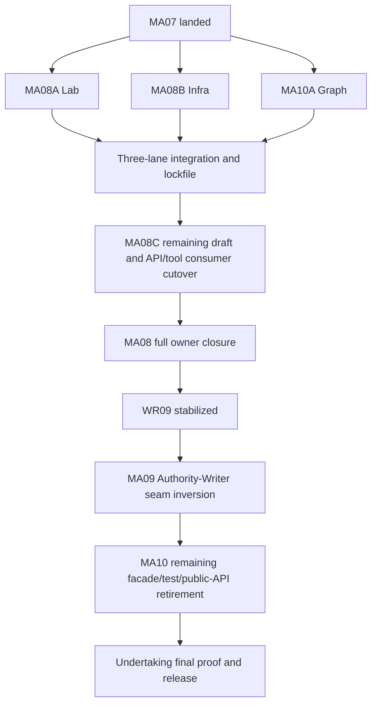

# Parallel-first structural execution | MA08A + MA08B + MA10A

**Planner disposition:** Selected three-lane execution topology; **integration target** `undertaking/storyteller-workshop`, never main. **Common code base:** MA07 landed at `4168db589eff302dab176e532d53db0425cd853c`; the latest actual branch SHA must be recorded by all parents before making worktrees. Each parent starts from the same final planning HEAD, in its own linked worktree, not a branch created from another parent. Source audit baseline `e122d080`; no implementation tests run by ChatGPT.

## Three simultaneous commissions

| Cursor chat | Change packet | Exclusive implementation writes | Can execute concurrently with |
| --- | --- | --- | --- |
| **A** | [MA08A lab-support extraction](../../changes/open/2026-11-21--ma08a-lab-support-extraction/CHANGE.md) | `packages/lab-support/**`, `tools/chamber/**`, at most Story Engine nested read-only fixture export in `packages/story-engine/package.json` | B + C |
| **B** | [MA08B infrastructure extraction](../../changes/open/2026-11-21--ma08b-infrastructure-owner-extraction/CHANGE.md) | `packages/db/{src/outbox-relay.ts,package.json}`, `packages/runtime-logging/**`, exact API/GA/Worker logging and Worker relay/runtime files, host manifests | A + C |
| **C** | [MA10A module-graph instrumentation](../../changes/open/2026-11-21--ma10a-module-graph-instrumentation/CHANGE.md) | `scripts/repo-tools/module-graph{,-core,.test}.mjs` | A + B |

**Shared files forbidden to all three implementation parents:** `pnpm-lock.yaml`, `work/QUEUE.md`, `work/changes/README.md`, `work/undertakings/**`, `STATUS.md`, cross-lane technical docs, root scripts. Only integration custodian updates these **after branch integration**. A owns `packages/story-engine/package.json` exclusively; B must NOT move drafts or touch that manifest. A must NOT touch `apps/api/src/app.ts` or API developer controllers. C does not rewrite existing AST checker fail policy or run package migration. Scope is intentionally narrower than previous broad MA08/MA10.

## Integration custodian and Git sequence

Appoint **one integration custodian** for the complete three-lane batch before dispatch (the user can use one Cursor parent after its own branch has a verified receipt, or ChatGPT supervising GitHub); no self-merging independent parents while other lanes run. After all three parents finish implementation and focused tests and provide branch SHA, custodian:
1. Checks current `undertaking/storyteller-workshop` HEAD, each branch's merge base and unchanged tracked user work. Avoid resets, force push, detached main, deleting active worktrees.
2. Integrates **B → A → C** into undertaking, using repository Change squashed integration policy, with a verified new HEAD after each. These are **three independent whole Changes**; preserve distinct Change receipts/ledger/archive closure and commits. File-disjointness permits clean integration; **do not assume** merge without checking drift.
3. Regenerates **one authoritative** pnpm lockfile from the joined package manifests; run scoped build/typecheck, graph and focused tests of all three combined; no network model calls, no protected SQL.
4. Updates each packet status/archive, `work/changes/README.md`, undertaking OVERVIEW/PROGRAM/UNDERTAKING, and any tech doc changes required by these selected code contracts. Keep honest PASS/FAIL/NOT RUN and pre-existing worker/compiler issues.
5. Pushes verified integration HEAD, retires three temporary branches/worktrees **only after** receipts and safety checks. On a safety-critical test failure or specific integration conflict, stop with affected file/command/expected behavior rather than destructive retry.

**Worktree qualification:** `node scripts/repo-tools/change-branch-guard.mjs --change <MA08A|MA08B|MA10A> --target undertaking/storyteller-workshop` before any edit, under actual named Change branch. No parent grabs another branch or shared primary checkout. `pnpm install` may mutate lockfile *locally*, but that diff is never part of the lane commit; merged custodian owns lockfile truth. Baseline builds can be red due to unrelated preexisting issues; do not label them green.

## Actual dependency DAG after this parallel batch

**Important:** WR09 planner work can continue in ChatGPT while implementation lanes run; after its execution interfaces are frozen, its code may be schedulable in parallel with independently owned MA08C subwork only after a fresh collision matrix. The diagram expresses conservative integration order, **not** a blanket ban on future parallel work.

## Superseded umbrella packets and consistency rules

Earlier [MA08](../../changes/open/2026-11-21--ma08-application-owner-extraction/CHANGE.md) was a single broad Change and is **withdrawn from direct Cursor dispatch**; its constituent scope is reassigned to MA08A, MA08B, and a future MA08C for drafts, remaining API developer routes, scripts, manifests and legacy source owner cutover. It is retained as a planning source, **not** a fourth simultaneous executor.
[MA09](../../changes/open/2026-11-21--ma09-authority-writer-dependency-inversion/CHANGE.md) still needs WR09 stable interfaces, and [MA10](../../changes/open/2026-11-21--ma10-module-boundary-enforcement/CHANGE.md) still depends on their integrated results. **Do not commission those two now just to fill Cursor seats.** MA10A is explicitly independent, scoped AST instrumentation; it does not prematurely remove Application or enforce rules that current source violates.

**General rule for future waves:** whenever possible prepare two or three concurrently executable Changes, with exact non-overlapping write ownership, frozen interfaces, a single custodian, independent branches/worktrees, a defined join order and combined negative tests. Never inflate work into fake concurrent packets that are actually serially dependent.
