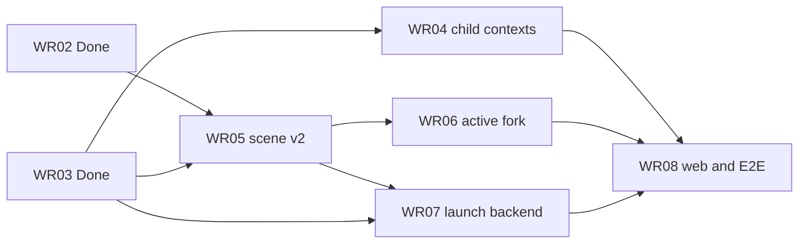

# Writer implementation | Storyteller Workshop

**Owner:** [Storyteller Workshop](UNDERTAKING.md). **Integration target:** `undertaking/storyteller-workshop` (never individual WR → `main`). **Purpose:** dependency map and planner gate, not a second work queue or permission to spend. [Global selection](../../QUEUE.md) controls default work; owner may commission a named independently ready Change. **Re-audited 2026-11-21** against source snapshot `dac6b698`, selected remote key anchors at undertaking HEAD `7fccbc6417b4959985c633a9c073571a032030ba`. These are **source-inspection observations, not runtime test passes**. Later packet-audit documentation commits advance branch HEAD without changing the inspected code.

> **Next substantial execution after WR05P2 integrated (2026-11-21):** WR08A, WR05P1, WR07M, WR07N, WR07L and **WR05P2** are Done/archived. [WR07B first-scene Launch](../../changes/archive/2026-11/storyteller/2026-11-21--wr07-one-prompt-launch-backend/CHANGE.md) and [WR06 active historical forks](../../changes/archive/2026-11/storyteller/2026-11-21--wr06-fork-active-fictional-state/CHANGE.md) are Done. **Critical honesty:** Writer-v2 option presentation is not executable player intent through the legacy Storyteller response route. WR07B must not expose dead buttons or claim scene-2 playability; the later Living Writer macro outcome owns authorized intent and continued scenes. See [combined completion ledger](UNDERTAKING.md). Old pre-MA06A WR04/05/06/07/08 T-IDs remain obsolete.

| Change | Outcome | Reality and current execution disposition |
| --- | --- | --- |
| WR02 | Persistent Library/source identity | Done, archived |
| WR03 | Writer mission and Workdesk | Done, archived; `storyteller_writer_mission` and `storyteller_writer_step` now exist |
| [WR07M](../../changes/archive/2026-11/storyteller/2026-11-21--wr07m-opening-writer-mission-scope/CHANGE.md) | Opening writer-mission scope | Done, archived; v2 opening capture pins reserved ids and does not admit a story or call a provider |
| [WR07N](../../changes/archive/2026-11/storyteller/2026-11-21--wr07n-writer-opening-scene-proposal/CHANGE.md) | Opening scene proposal | Done, archived; v2 opening finals carry passage content and do not publish or call a provider |
| [WR04](../../changes/open/2026-11-21--wr04-delegated-writer-research/CHANGE.md) | Separate bounded writer-child contexts | **PLANNER-BLOCKED:** WR03 step/custody still assumes `contextId=missionId`; read-only tool/child budget/attempt/join maps not frozen |
| [WR05](../../changes/open/2026-11-21--wr05-coherent-scene-publication/CHANGE.md) | Complete v2 scene commit + active semantic state | **PLANNER-BLOCKED:** world-state schema/after-image projector/SQL migration/note transaction design not fully decided |
| [WR06](../../changes/archive/2026-11/storyteller/2026-11-21--wr06-fork-active-fictional-state/CHANGE.md) | Historic active-state fork | **Done (2026-11-21).** v2 scene fork remaps active commitments onto a child story. Not on main |
| [WR07](../../changes/archive/2026-11/storyteller/2026-11-21--wr07-one-prompt-launch-backend/CHANGE.md) | Idempotent authenticated one-prompt Launch | **Done (2026-11-21).** Scripted authenticated prompt publishes one readable v2 scene. Choice buttons stay unpublished. Web flag stays off. Not on main |
| [WR07L](../../changes/archive/2026-11/storyteller/2026-11-21--wr07l-durable-launch-ledger/CHANGE.md) | Durable Launch operation ledger | **Done** on `undertaking/storyteller-workshop`. Internal `story_launch` row and Game Authority admission. No HTTP route, no story row, and no provider call. Does not unblock WR07 |
| [WR08A](../../changes/archive/2026-11/storyteller/2026-11-21--wr08a-play-launch-surface/CHANGE.md) | Gated one-prompt Launch screen | **Done** on `undertaking/storyteller-workshop`. Web only. Flag default off until the Launch backend exists. Not integrated acceptance |
| [WR08](../../changes/open/2026-11-21--wr08-one-prompt-client-and-integrated-acceptance/CHANGE.md) | UI launch/history/fork and scripted acceptance | **PLANNER-BLOCKED:** depends on actual WR04, WR06, WR07 response and fixture contracts; current T01 is source-only, not a PATCH |

## Next dispatch once WR05P2 lands

**Owner-commissioned pair (WR05P2 Done/archived):** WR06 and WR07B are Done on the undertaking. The successor routes superseded older pre-MA06A T-IDs. WR07 owns Launch/Writer/GA/API/Worker/DB migration/Web stories. WR06 owns fork engine, fork lineage in Storyteller context and Web play/history, and that work has landed. Both treated v2 snapshot/schema/reader as read-only. Distinct linked worktrees, distinct disposable SQL databases, serial final squash integrations. Full Undertaking continues to Writer research/provider, bulk monorepo cleanup, acceptance and main landing. If WR05P2's output cannot represent required active state or scene-one publication, pause the affected Change at the exact incompatibility; do not silently weaken acceptance or spawn micro-Changes.

## Dependency and concurrency plan

These are **logical dependencies, not verified parallel-work permissions**. Do not automatically run WR04+WR05 simultaneously: both may edit `packages/application/src/storyteller/*`, writer publication and related migrations. Do not assume WR06+WR07 can run simultaneously: fork/Launch may share story-authority composition, API/GA seam, migration files, story selectors and disposable SQL fixtures. Before any simultaneous Change commissions, **ChatGPT** must publish exact files/resources/exports and a verified disjointness matrix; one integration custodian serializes merges. Within one ready packet allow up to two truly independent Composer workers only when the packet proves no source/generated output/fixture/Git collisions. Otherwise serial is preferable.

## Planner's next bounded work, not paid Cursor work

1. **WR04:** specify context-qualified writer step/custody signatures, child budget SQL and tool enforcement; write exact T-ID maps and focused negative tests, then independent G0–G7.
2. **WR05:** freeze canonical v2 schema/size policy, after-state transition table, SQL version migration and pre-stage/lock/adopt proof; split if necessary and independently audit.
3. **WR06 and WR07:** after WR05 is integrated, map exact v2 ID remap vs Launch scene-one/custody and test fixtures. Independently inspect concurrency and update each Change.
4. **WR08:** only after backend contracts are landed, select precise UI hooks/routes and existing harness; isolate functional zero-provider acceptance from optional funded creative quality.

The `SOURCE-MAP.md` and `PROOF.md` for each Change include its initial G0–G7 audit and observed failure modes. WR08A is the commissioned web Launch surface and is Done; it does not publish a backend or claim integrated Play. All current WR04–WR08 T-IDs are explicitly **PLANNER-BLOCKED**, so “do WR04” must not cause a Cursor design expedition. ChatGPT prepares/re-audits the specific next packet first. After a packet passes and the owner commissions it, Cursor completes that **whole Change** through verified proof, reconciliation, squash integration, archive and clean worktree retirement without automatic successor dispatch.

**Historical provenance, not active instructions:** [original implementation program](https://github.com/DenisSkulovic/offscreen-rpg/blob/4ee459b9acdc73c7f63674b697baeb9c7e685da4/work/changes/WRITER-IMPLEMENTATION-2026-11-21.md), [documentation handoff](https://github.com/DenisSkulovic/offscreen-rpg/blob/4ee459b9acdc73c7f63674b697baeb9c7e685da4/work/changes/WRITER-DOCS-CHATGPT-HANDOFF-2026-11-21.md), and [old Composer audit](https://github.com/DenisSkulovic/offscreen-rpg/blob/4ee459b9acdc73c7f63674b697baeb9c7e685da4/work/changes/WR-COMPOSER-HANDOFF-AUDIT-2026-11-21.md). These do not supersede current code or current readiness.

**Exit:** only after the undertaking's actual implementation/evidence and canonical documents are reconciled, use its integration and retirement procedure; never mistake planning completion for proof.
