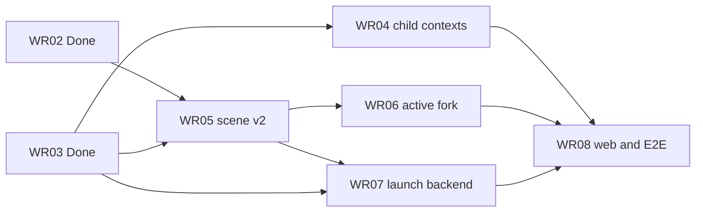

## Future external-service spending reconciliation and reliability (2026-11-22; proposed)

External providers expose a second, eventually consistent source of financial evidence beyond the application's immediate authorization and reservation. The user wants **all legitimate vendor expenses attributed and reconciled to the smallest available currency unit**, including delayed/missing/corrected OpenRouter usage and future image-generation costs, with honest unresolved evidence. Add four separate **Proposed** owners: [FIN01](../../changes/backlog/policy-finance/2026-11-22--fin01-provider-usage-reconciliation-ledger/CHANGE.md) for provider-native evidence, append-only matching/adjustments and unmatched balances; [FIN02](../../changes/backlog/policy-finance/2026-11-22--fin02-provider-cost-adapter-contracts/CHANGE.md) for route-specific native metering units/price versions and upper bounds; [PROV01](../../changes/backlog/policy-finance/2026-11-22--prov01-provider-health-outage-and-routing/CHANGE.md) for outages/retirement/429/unknown-send and safe fresh-route admission; [FIN03](../../changes/backlog/policy-finance/2026-11-22--fin03-internal-spend-controls-and-investigation/CHANGE.md) for audited internal Admin/Finance operations and anomaly monitoring.

**Preserve existing financial authorities:** `@offscreen/story-engine` Writer funding/usage-window SQL remains the one reserve/settle gate, `@offscreen/storyteller` policy/pricing retains bounded provider transport, CFG01/CFG03 choose future effective eligible policy, ADI03 displays historical effective policy, and EV01 controls optional budget-conscious experiments. FIN01 is **post-dispatch reconciliation**, not another account money balance or an excuse to free unknown spend. If supplier detail cannot be correlated to attempts, retain it as unmatched/disputed rather than fabricating an equal cent. Normalize exact currency/native units without float drift; create compensating entries for corrections. First prove all logic with synthetic delayed provider feeds; real OpenRouter usage API/invoice capabilities need explicit fresh vendor verification before source-grounded implementation.

This creates **35 named brainstorm Change outcomes** with existing previous 31; it does not imply a 35-change implementation sprint, current source completeness or any actual provider spending. [Catalog](../../changes/README.md#external-provider-usage-costs-reconciliation-and-reliability-4-more-2026-11-22) · [minutes](../../sessions/2026-11-22.md#14-external-provider-economics-usage-delayed-reconciliation-model-outages-and-multi-product-financial-integrity). `work/QUEUE.md` unchanged, no Cursor commission, no provider money, no migration.

## Future database engineering and whole-game data preservation (2026-11-22; proposed)

The owner requested a practical, learning-oriented **production data lifecycle** even while the game has no customers. Three separate future Changes, all **PROPOSED**, are [DBOPS01](../../changes/backlog/platform-operations/2026-11-22--dbops01-safe-schema-migrations-and-release-compatibility/CHANGE.md) for expansion/backfill/contract, one migration runner, mixed old/new application versions and migration interruption; [DBOPS02](../../changes/backlog/platform-operations/2026-11-22--dbops02-postgres-operational-health-and-performance/CHANGE.md) for PostgreSQL diagnostics, pool/lock/index/WAL/autovacuum/capacity management, and [DATAOPS01](../../changes/backlog/platform-operations/2026-11-22--dataops01-cross-store-backup-restore-and-retention/CHANGE.md) for backup/retention/privacy and restoring PostgreSQL, Temporal workflow progress, private CAS/Library source and configuration coherently into a new disposable environment.

**Overlap discipline:** [SCALE02](../../changes/backlog/platform-operations/2026-11-22--scale02-stateful-data-and-workflow-ha/CHANGE.md) owns replica topology, primary election and HA; [SQL01](../../changes/backlog/platform-operations/2026-11-22--sql01-transaction-and-lease-source-audit/CHANGE.md) owns correctness of domain-level transactions; [LOAD01](../../changes/backlog/platform-operations/2026-11-22--load01-scripted-multiuser-load-and-autoscaling/CHANGE.md) supplies eventually observed load; [AI02](../../changes/backlog/agent-runtime/2026-11-22--ai02-durable-agent-execution-provenance/CHANGE.md) informs private evidence/retention. Existing migration runner and game-migrate are a foundation but not a tested online release process. Postgres standby schema ordinarily replicates the primary's WAL and is not independently changed in normal schema rollout. Capture RPO/RTO and disaster-domain decisions when real environments exist, not hard-coded guesses now. [Current catalog: 31 named brainstorm outcomes](../../changes/README.md#production-minded-database-and-data-lifecycle-3-more-2026-11-22). `work/QUEUE.md` remains unchanged; **no live database, provider, billing or cluster authorization granted**.

## Future replicated deployment and zero-cost throughput proofs (2026-11-22; Proposed)

The owner requested a later transition from **one proven real game instance** to multiple application instances and deterministic load, with no paid provider. [SCALE01](../../changes/backlog/platform-operations/2026-11-22--scale01-replicated-application-runtime/CHANGE.md) verifies fixed replicated Web/API/GA/Worker roles; [SCALE02](../../changes/backlog/platform-operations/2026-11-22--scale02-stateful-data-and-workflow-ha/CHANGE.md) separately owns PostgreSQL primary+standby, backups/PITR, Temporal server/persistence and private document durability; [SIM01](../../changes/backlog/platform-operations/2026-11-22--sim01-realistic-zero-cost-provider-simulator/CHANGE.md) reuses actual Writer provider transport with scripted schema-valid responses/seeded latency/failures and hard no-real-network protection; [LOAD01](../../changes/backlog/platform-operations/2026-11-22--load01-scripted-multiuser-load-and-autoscaling/CHANGE.md) drives up to 100 separate fake-owner campaigns through normal authenticated APIs, observes CPU/SQL/outbox/Temporal/Pod loads and later HPA/KEDA scale-up/idle/down. These are **four new high-level Proposed work units**, extending named brainstorm coverage to **28**, not twenty-eight executable tasks.

**Gates:** TURN03 real single-instance success first, K8S10 one-Pod failure/<=9-command baseline second; WR10/WR11 provider custody before SIM01; SCALE01 fixed replication safety before HPA-backed LOAD01; SCALE02 independent stateful HA/failure-domain test requiring actual operator design. One node kind is a capacity lab, not multi-node HA. Ingress may have one public endpoint, not necessarily one failure-proof proxy Pod. Simulated provider spends no real LLM money, though synthetic billing must still obey the existing custodial ledger. Current Changes and worktrees must finish, so no autoscaling, database cluster, load spike, or paid cloud service is commissioned by this plan. [Catalog and owner notes](../../changes/README.md#future-horizontal-scaling-and-zero-funded-load-rehearsal-4-more-2026-11-22) · [Minutes](../../sessions/2026-11-22.md#12-owner-asks-for-future-minimal-horizontal-scalability-and-100-user-zero-llm-load-rehearsal).

## Added historical Admin workspace and safe policy re-admission (2026-11-22; uncommissioned)

The owner's [same-day minutes](../../sessions/2026-11-22.md#11-admin-must-be-an-inspectable-historical-story-workspace-not-just-a-dashboard) now include four additional bounded future Changes, taking **the brainstorm coverage to 24**, with [canonical catalog](../../changes/README.md#extended-admin-historical-inspection-and-safe-resume-proposals-4-more-2026-11-22). [ADI01](../../changes/backlog/experience-admin/2026-11-22--adi01-scene-history-game-state-explorer/CHANGE.md) owns an authorized story/scene before-and-after state timeline; [ADI02](../../changes/backlog/experience-admin/2026-11-22--adi02-historical-library-explorer/CHANGE.md) owns a historical pinned-root Markdown/Library explorer and diff; [ADI03](../../changes/backlog/experience-admin/2026-11-22--adi03-effective-policy-history-explorer/CHANGE.md) owns source-backed per-scene mission policy/provider/entitlement decisions with separate safe roles; [CFG03](../../changes/backlog/policy-finance/2026-11-22--cfg03-resume-policy-eligibility-and-portability/CHANGE.md) owns new-mission eligibility after months, plan changes or unavailable models while old attempted charges remain pinned. Ownership transfer is only a hypothetical security/portability stress case.

**Dependency/overlap gate:** the existing staff Admin architecture and per-case privacy rule remain canonical, [HR01](../../changes/backlog/quality-evaluation/2026-11-22--hr01-api-route-ownership-readability/CHANGE.md) owns endpoint structure, [AI03](../../changes/backlog/agent-runtime/2026-11-22--ai03-staff-agent-context-inspector/CHANGE.md) owns prompt/tool traces, [CFG02](../../changes/backlog/policy-finance/2026-11-22--cfg02-admin-policy-management/CHANGE.md) owns policy mutations, [CFG01](../../changes/backlog/policy-finance/2026-11-22--cfg01-versioned-writer-execution-policy/CHANGE.md) owns effective resolver/pins. Do not duplicate those layers. Platform model routing is internal: a public quality label need not promise permanent vendor/model identity, but no label grants spending permission. Source scope and staff grants must be decided before dispatch. No real story exports, broad staff content access or funded requests authorized.

## Brainstorm inventory and staged future Change ownership (2026-11-22)

All 2026-11-22 owner brainstorming now maps to **20 distinct existing or newly proposed bounded Changes** in the [canonical grouped catalog](../../changes/README.md#complete-2026-11-22-brainstorm-to-change-coverage-map-20-bounded-outcomes) and [dated owner minutes](../../sessions/2026-11-22.md). The final four otherwise-missing high-level outcomes were recorded as [WR12 generated opening](../../changes/backlog/agent-runtime/2026-11-22--wr12-provider-authored-opening/CHANGE.md), [CTX01 context selection/packing](../../changes/backlog/agent-runtime/2026-11-22--ctx01-context-composition-and-retrieval-policy/CHANGE.md), [DX13 measured affected/cache](../../changes/backlog/quality-evaluation/2026-11-22--dx13-measured-monorepo-build-cache/CHANGE.md), and [SQL01 transaction/lease human audit](../../changes/backlog/platform-operations/2026-11-22--sql01-transaction-and-lease-source-audit/CHANGE.md). These are shallow Proposed records, **not technical instructions ready to execute**.

Do not merge their concerns: **WR12** differs from WR11's provider continuation; **CTX01** assembles what the model *sees* rather than CFG01's numeric limits or AI02's historical archive; **DX13** measures real cache correctness rather than reimplementing the completed DX12 selector; **SQL01** investigates correctness/recoverability and teaches the human owner rather than repeating HR03's table-definition rearrangement. Reuse the existing Chamber, Eval and Admin policy proposals, never create duplicate owners.

**Next work is gated by demonstrated predecessor source.** Current three changes and subsequent Writer/client/cluster readiness take priority. The owner has requested historical preservation and high-level planning, **not** launching all 20. Keep the existing `work/QUEUE.md` selector unchanged. Paid provider evaluation remains **$0 authorized by default**; no packet or upper-limit estimate authorizes spend. No implementation, build, cluster or financial proof was run during this planning update.

# Storyteller Workshop | current execution program

## 2026-11-22 owner brainstorm preserved: economy, policy and Chamber

Read [dated minutes](../../sessions/2026-11-22.md) for the owner's **reconstructed** thoughts, motives, objections and links, not as accepted implementation rules. New **proposed** and **not-dispatchable** packets:

- [CFG01 typed versioned Writer execution policy](../../changes/backlog/policy-finance/2026-11-22--cfg01-versioned-writer-execution-policy/CHANGE.md): source reconcile B1/B2 entitlement/funding/usage-window owner and WR11 actual SQL-capable Worker admission; replace hard-coded v3 effort numbers with server-resolved immutable snapshots only after transaction proof.
- [EV01 centwise eval evidence](../../changes/backlog/quality-evaluation/2026-11-22--ev01-centwise-agent-evaluation/CHANGE.md): reuse Lab Support evaluator/oracle/preflight; all deterministic/re-score by default ($0), one paid inference only with explicit exact user approval and strict ledger-backed reservation. A quoted $0.75 upper suggestion is not a spending allocation.
- [CH01 Chamber Scenario × Recipe × Experiment](../../changes/backlog/experience-admin/2026-11-22--ch01-chamber-experiment-workbench/CHANGE.md): hypothetical scene-20 setup in *disposable* canonical state, preview/fake run, source-pinned human comparison and saved cost/quality evidence, no independent engine or production credentials.
- [CFG02 Admin config governance](../../changes/backlog/policy-finance/2026-11-22--cfg02-admin-policy-management/CHANGE.md): later draft/validate/publish/rollback with capabilities/audit, **deferred** until CFG01 is accepted.

**Scope decision:** do not create alternate funding, policy or evaluation engines. Existing selected [platform spending authority](../../../docs/technical/platform/spending-and-entitlements.md) separates entitlement, funding, task recipe, creative profile and windows, and must remain canonical. Existing `writer-continuation.ts` has a pinned 4-round/8000-input/2000-output/$0.25 budget that still needs a real dynamic admission recipe. No implementation tests or paid calls have occurred during this brainstorming. Preserve current/previous batch execution priorities; do not automatically make any of these `work/QUEUE.md` current work.

**Source-inspected checkpoint:** 2026-11-22 at `d3ba291763de26a0135c1ad84b077bf4f1c153a8`. **State:** active undertaking; **Current work:** [none](../../QUEUE.md). [Human overview](OVERVIEW.md) is the supervisor's first read; [full evidence ledger](UNDERTAKING.md#2026-11-22--source-audit-checkpoint-at-d3ba2917) owns nuanced Done/NOT RUN distinctions. These headings supersede the historical 2026-11-21 batch contracts below.

## Future Agent Internals and Inspectability sequence (2026-11-22; planned, NOT DONE)

Owner goal: personally understand Storyteller capture, context composition, Library tools, agent loop and Temporal orchestration, then debug an old scene's request, tool actions and output in a structured UI. Inspected baseline source `f8a45a7e` reveals `writer-loop.ts` 1,302 lines, `context-capture.ts` 3,079, `capture-materialization.ts` 1,598, plus Workflow contracts and outbox dispatch distributed across packages. Current round compiler supplies a fixed system message and a JSON **pin/receipt summary**, not the entire Library. Strict private responses are stored, but an exact historical outbound request archive for all rounds has **not been established**.

**Ordered stages:** [AI01 agent code and Temporal navigation](../../changes/backlog/agent-runtime/2026-11-22--ai01-agent-runtime-and-temporal-navigation/CHANGE.md) → [AI02 immutable Writer request/tool request evidence and transcript](../../changes/backlog/agent-runtime/2026-11-22--ai02-durable-agent-execution-provenance/CHANGE.md) → [AI03 Admin context/timeline/diff inspector](../../changes/backlog/agent-runtime/2026-11-22--ai03-staff-agent-context-inspector/CHANGE.md). **Not a parallel batch.** AI01 requires post-WR11 Writer source rebase, AI02 requires after AI01 + HR03 and verified retention/deletion, AI03 requires AI02 + HR01 and a new case/campaign-scoped sensitive-staff capability. Each is PLANNER-GATED; later packet readiness and source symbols must be revisited before Cursor commission. Do not splice new task code into WR10/WR11, Admin HR01 or schema HR03 concurrently.

**Reproducibility truth table:** exact archived wire bytes/hash is primary historical evidence; same original compiler+pins with same digest gives a hash-matched reconstruction, not proof of archived bytes; current compiler run without source pins is **not** historical; absent or private data is unavailable/redacted. A fork regenerates **new** context from a historical fictional state, possibly with new tool actions/model output; historical request reproduction is a different operation. Provider thinking/hidden reasoning is not available merely because model usage returns a token count. Temporal history contains workflow signals/activities and retries, **not agent chat transcripts**. Future Admin sees only permitted indexed private material; general staff/players never receive raw prompts.

**No spend, no completion credit:** source-only designs were written, not tested. The current [OVERVIEW](OVERVIEW.md) percentages remain unchanged. Do not install another generic agent framework merely to present the same loop under a different API.

## Human readability / ownership refactor wave, prepared (2026-11-22)

The owner intends to personally read and eventually own the Nest API, Next app and SQL workflows. In the current inspected code `StoriesController` ~644 lines, `AdminController` ~849, `app.ts` ~415, flat 13-file `features/stories`, and a 1,240-line `packages/db/src/schema/storyteller.ts` are real navigation costs. The existing Play `api/model/presentation/ui` split is already useful and should not be razed. Most SQL queries execute in Story Engine, **not** inside the DB workspace.

The fixed ownership targets are [HR01](../../changes/backlog/quality-evaluation/2026-11-22--hr01-api-route-ownership-readability/CHANGE.md) Nest controllers grouped by endpoint family and explicit DI, [HR02](../../changes/backlog/quality-evaluation/2026-11-22--hr02-web-player-feature-readability/CHANGE.md) Stories library/drafts/opening/launch folders plus selective Play presentation readability, and [HR03](../../changes/backlog/quality-evaluation/2026-11-22--hr03-db-schema-and-sql-navigation/CHANGE.md) five nested Drizzle schema lifecycle modules behind an unchanged exported barrel plus an accurate Story Engine SQL navigation atlas. These are **mechanical/readability Changes**: preserve contracts, operations, permissions, SQL schema, locks, Zod parsing semantics, frozen command retries and tests. Composer may perform bounded import renames, helper extraction and formatting without line-by-line planner prescriptions. No generic `utils` dump or helper-per-file explosion.

**Planning gates:** HR01 follows MA12 AND CL01 because both change Nest API composition; source rebase is the planner's job. HR02 is independently dispatchable when the Web source write set is clear. HR03 is independently dispatchable under strict fingerprint, without editing CL01's DB auth migration or WR11 SQL implementations. Once all three are eligible, use HR03 parent as single integration custodian, join HR03→HR02→HR01, then run combined builds, route/auth and Drizzle metadata negative proofs. This wave is additional planned work, **not permission to interrupt current Cursors or self-start another Change**. It receives no completion credit before evidence.

**Human tour acceptance:** start from app.ts and a route-family README to find an endpoint in <=2 hops; from Next story page to library/launch/play feature in <=2; from DB schema barrel to a table and SQL-OWNERSHIP map to its transactional query owner without guessing. Keep existing behavioral tests; avoid generating narrow tests tied to private file layout. Current [OVERVIEW](OVERVIEW.md) scope estimates remain unchanged.

## Subsequent three-lane wave, designed in advance (2026-11-22; not implemented)

**Dependency DAG:** current WR10 → future [WR11](../../changes/open/2026-11-22--wr11-authorized-provider-continuation/CHANGE.md); current MA12 → future [CL01](../../changes/open/2026-11-22--cl01-terminal-player-client/CHANGE.md); current TURN03 cold-kind PASS → existing [K8S10](../../changes/open/2026-11-19--k8s10-distributed-fault-and-load-harness/K8S10-CURRENT-EXECUTION.md). In next wave, CL01, WR11 and K8S10 source tasks have disjoint files. No current-wave Cursor should touch a successor while implementing the current three.

**CL01** builds a secure, browser-approved terminal sign-in plus public player experience (launch, play, choice, history, fork, machine-readable public snapshots) via the same Nest story routes. Production-only player-story bearer cannot authorize Admin/Drafts/private GA. It owns terminal-auth tables/migration and API story identity; no Game Authority/Worker changes.

**WR11** gives a real authored **continuation** after scripted opening. Server-side funding/model/price policy selects a new append-only provider Writer-scene notice/workflow, under WR10's GA financial/privacy boundary and the executor's provider I/O role. Never reinterpret historic scripted writerSceneV1; research.delegate remains unsupported/held on first provider slice. Because WR10 is not integrated yet, **WR11 remains planner-gated** until ChatGPT reconciles actual exported interfaces and final finances. Free fake-network, SQL, local process and real player proofs precede any paid call. **Proposed paid smoke:** max USD $0.75 total, max 3 attempts at <=$0.25 per mission worst-case each, exact model+price, separate task-specific owner approval, no unknown retry. Nothing paid has been authorized or run.

**K8S10** continues the EXISTING Change, not a new chaos subsystem. Its read-only selector/preflight/Oracle are source-implemented. [Current execution](../../changes/open/2026-11-19--k8s10-distributed-fault-and-load-harness/K8S10-CURRENT-EXECUTION.md) finishes real baseline binding, exactly one eligible graceful executor Pod replacement, single logical effect oracle and <=9 scripted commands over <=60s. Cluster faults require genuine TURN03 PASS, exact cluster/deployment/Pod UID/digest and owner approval; no model/DB reset. Mock tests cannot close a live chaos gate.

**Next-wave integration owner:** CL01 parent, once explicitly commissioned and after prerequisites. Source joins **WR11 → CL01 → K8S10 harness**, one shared lockfile, combined permissions/monorepo tests; live K8S10 operator run is separate after joined commit. The rest of Storyteller vision (provider opening, research-child provider, HA, restore, broad quality evaluation, MA09 module inversion) remains outside these packets. The [OVERVIEW](OVERVIEW.md) percentages receive **zero completion credit** for creating planning documents.

## Selected next engineering wave (2026-11-22; source-grounded, NOT YET IMPLEMENTED)

**The three source-disjoint Change packets are now prepared, not Done.** [WR10](../../changes/open/2026-11-22--wr10-private-writer-round-protocol/CHANGE.md) creates the proper private **GA custody→executor I/O→GA durable settle** split, using fake provider only; [MA12](../../changes/open/2026-11-22--ma12-production-api-lab-isolation/CHANGE.md) removes Lab implementation from the production API by adding a one-way outer `@offscreen/api-lab` workspace; [TURN03](../../changes/open/2026-11-19--turn03-full-distributed-forkable-turn-proof/CHANGE.md) finishes the *existing*, not duplicated, kind acceptance harness and eventually runs the real signed-in scripted story/choice/fork through the cold cluster. See TURN03's [current execution](../../changes/open/2026-11-19--turn03-full-distributed-forkable-turn-proof/TURN03-CURRENT-EXECUTION.md).

**Why this order matters:** the isolated executor cannot receive SQL/DocumentStore credentials, so it cannot call WR09B's `runDurableWriterMissionModelRound(database,...)` directly. WR10 strictly separates provider I/O from GA authorization/cost/private storage. It does not yet wire a new Temporal Writer mission or user Launch, and no real paid call is authorized. MA12's API packaging changes must be included in the image digests before TURN03's live proof. No new package is planned for Writer yet; an outer API Lab package is specifically justified by production deployment/dependency isolation.

**Parallel file/resource map:** WR10 owns `packages/story-engine/src/storyteller`, `packages/contracts/src/writer-round-private-custody.ts`, new/targeted GA+Worker private round HTTP and WR10 tests; MA12 owns `apps/api`, `tools/api-lab`, Chamber and explicitly named developer-only API Integration helpers; TURN03 owns only its new `infra/kubernetes/lab/app-release/turn03/**` harness, new pure evidence test, and its own Change documents. Shared `pnpm-lock.yaml`, catalogs, overview, status and technical reconciliation are one custodian's responsibility. Unique SQL sandbox for WR10, pure MA12 tests in parallel; one kind operator and final TURN03 run only after source join.

**Custodian = MA12 Cursor C.** Each parent creates linked worktree from current undertaking, implements and tests its whole source scope, pushes Change branch SHA plus concise positive/negative receipt. C serially joins **WR10 → MA12 → TURN03 harness** with current HEAD reconciliation, one lockfile update, combined builds/graph and environment-safe proofs; pushes undertaking and archives only demonstrated code outcomes. TURN03 runtime gate then exercises the **joined release**; it remains open if authentication, cluster, or mandatory cross-Pod evidence is missing. Existing `work/QUEUE.md` stays `none` until owner explicitly selects a default; user may commission these three independently. No paid provider, destructive cluster reset, secret disclosure, or automatic main merge.

**Impact/limits:** These are three material advances, **not** a claim the product is delivered. WR10 establishes secure split custody but not player routing; MA12 removes a real production dependency but does not resolve MA09; TURN03 verifies scripted Kubernetes gameplay and cannot certify AI creative quality or horizontally scaled HA. [OVERVIEW](OVERVIEW.md) completion estimates remain unchanged until accepted evidence changes the risk assessment.

## Current conclusion, not another preauthorized Cursor queue

**Completed:** MA10, WR09A and MA11; then WR09B, OPS12, DX12 all archived on this undertaking branch. Their test receipts cover migrated files, strict **offline** provider custody, fake multi-round Writer, injected Worker cleanup, and a local affected-build *planner*. No normal Worker activity invokes the durable Writer round. Full worker TypeScript compile is reported blocked by a generation-evidence GameAuthoritySeam type mismatch. The complete application has not been shown running in a cold Kubernetes cluster with a player/Writer/fork path, and no paid model or restore/load proof has occurred.

**Next product critical path:**
1. **Restore trustworthy green source/boot evidence.** Reproduce/fix the Worker typecheck blocker before assuming any full build works; run scoped builds, graph, unit and disposable integration checks. Keep negative authentication, amount, revision and privacy tests.
2. **Real Writer task adapter and admission composition.** Reinspect open [WR09](../../changes/open/2026-11-21--wr09-provider-ready-writer-runtime/CHANGE.md). Its WR09A/B custody/replay phases have landed; its still-missing portion is Worker activity routing, model/price/spend/credential policy at an authorized host, initial opening vs v3 continuation compatibility, delegated research wake/join and Game Authority scene publication. Define exact provider-free failure/replay algorithm before sending Cursor code work. Ordinary Launch is still scripted-offline. A real paid call needs separate explicit approval.
3. **Connected cold-kind product proof.** Reconcile [TURN03](../../changes/open/2026-11-19--turn03-full-distributed-forkable-turn-proof/CHANGE.md) with K8S11/DIST03 and the already-present app-release manifests; run authenticated browser→Nest→GA→outbox→Temporal→Worker→GA scene→SSE/GET→fork on a cold disposable cluster, including failure/owner/revision negatives. A local multiprocess STORY03 result is not a substitute.
4. **Distributed fault/load/operations.** Continue existing [K8S10](../../changes/open/2026-11-19--k8s10-distributed-fault-and-load-harness/CHANGE.md) *after* the connected POC: controlled Pod kills/restarts, duplicate/lost delivery, persistent-state continuity, queue saturation, traces, real load and recovery, no model spend. Align with the currently **NOT TESTED** restore-runbook gate.
5. **Authority/Writer packaging and quality.** Re-audit [MA09](../../changes/backlog/agent-runtime/2026-11-21--ma09-authority-writer-dependency-inversion/CHANGE.md) on current source, resolve five reverse imports without moving SQL transaction boundaries, then evaluate whether a true Writer-runtime package improves ownership and affected-build scope. Fix stale Application documentation links and failing wiki health. Measure DX12's actual cached execution; do not claim an automatic Jenkins optimization.

## Evidence tiers that must accompany every future packet/receipt

| Tier | Current | Required next proof |
| --- | --- | --- |
| Source / focused unit | Strong in many components; WR09B 4/4, OPS12 16/16, DX12 15/15 recorded | Clean all-workspace builds, quality and graph; no masked errors |
| Disposable SQL and local multiprocess | Writer custody/replay and STORY03 local causal + kill/replay tests | Full provider-free Writer→Player path in current host composition, source/fork/idempotence negatives |
| Cold connected Kubernetes | App-release manifests and independent infrastructure lab exercises | Actual browser-to-fork TURN03; K8S10 real Pod-fault game run |
| Real model + quality | Historical 2026 generations, **not the current architecture** | One explicitly authorized bounded provider spend, quality/continuity rubric over long session |
| Operability and release | Synthetic traces, no hosted restore | Real application trace/alerts, load/capacity, backup+restore and rolling compatibility, documented operator outcome |

**Planning hygiene:** do not assume completion just because a packet is archived, don't auto-commission a successor, and don't create duplicates of open WR09/MA09/TURN03/K8S10. Parallel Cursor work requires complete source/dependency/write-path maps and shared cluster/database ownership. Do not merge the undertaking into main until end-to-end gates are passed. User aims to resume planning tomorrow; this is an orientation, not scheduled background activity.

---

## Historical implementation plans and previous commissions (provenance only)

The remainder of this file describes earlier parallel waves and predecessor gates. Those words **are not today's work selection or execution permission**. The current `work/QUEUE.md` selector is `none`; only the checkpoint above and actual current Change documents govern tomorrow's planning.

## Post-MA08 three-lane execution contract (2026-11-21)

**Verified implementation base:** MA08 integrated at `6dd1276131a813f694ec3bccf4f9062ad3708208`. Planning-only commits advance branch HEAD; every Cursor worktree must fork the **current** undertaking integration HEAD, not the snapshot commit or `main`. The active selected batch has **three independently executable Changes** with distinct ownership, not three overlapping slices of MA08.

| Lane | Packet | Exclusive edits |
| --- | --- | --- |
| **A** | [MA10 compatibility retirement](../../changes/archive/2026-11/other/2026-11-21--ma10-module-boundary-enforcement/CHANGE.md) | `packages/application/**` deletion, `tools/api-integration/legacy-engine-tests/**`, API Integration manifest, legacy Worker test paths, old executable script references; no source Story Engine or graph checker |
| **B** | [WR09A provider response custody](../../changes/archive/2026-11/other/2026-11-21--wr09a-durable-writer-provider-response/CHANGE.md) | DB Writer response pointer/migration, `story-engine/src/storyteller/{writer-mission-custody,writer-mission-store,writer-provider-response,budget}.ts`, pure Writer provider transport and tests, distinct `tools/api-integration/test/wr09a-*.ts`; no legacy tests, API Integration manifest, Worker or game authority |
| **C** | [MA11 engine AST boundaries](../../changes/archive/2026-11/other/2026-11-21--ma11-story-engine-boundary-ratchet/CHANGE.md) | `scripts/repo-tools/module-graph-core.mjs`, `module-graph.mjs`, `module-graph.test.mjs` and scoped fixtures; **only** `apps/api/package.json`, `apps/game-authority/package.json` runtime-dependency corrections |

**Cursor A (the MA10 parent) is the designated integration custodian.** All three Cursor parents independently create linked Change worktrees, implement whole assigned T01–Txx and run scoped proof. B and C push their tested Change branches and send SHA/receipt to A, **without integrating into undertaking or retiring worktrees**. A retains its own tested MA10 branch and, once B/C receipts are available, checks branch heads and current integration HEAD, joins **MA10 → WR09A → MA11** serially (preserving per-Change commits/receipts and existing user work), generates one lockfile for combined manifests, runs joined graph, moved 112-test suites, DB migration/fake-provider custody, build/typecheck and negative safeguards on disposable resources. Then the custodian archives each Change, updates ledgers/overview/STATUS and pushes; only then retire temporary worktrees. If one independent branch finishes earlier, it can remain ready without being auto-merged. No force/reset, no conflicting shared docs and no paid calls.

**Shared SQL-resource rule for parallel execution:** MA10 executes its **60 pure** migrated tests while WR09A is working; MA10's 16 SQL/14 integration/22 live suites remain NOT RUN until its custodial join (or require demonstrably separate sandbox IDs). WR09A's new fake-provider integration test provisions a **unique** disposable sandbox DB with a fresh UUID and cleans it up, never using the fixed `offscreen_db_test` simultaneously with any sibling. MA11 has no DB tests. Only the custodian schedules joined disposable SQL suites after the three commits have been integrated. Do not treat separate worktrees as isolated databases.

**Hard safety gates:** MA10 never removes tests; WR09A settlement+response pointer are one SQL transaction after CAS put, and no interrupted send is re-sent; MA11 fixes exactly the two already-reported runtime imports incorrectly declared as dev dependencies, without silencing the graph checker or require zero pre-MA09 cycles. Do not start MA09 or the remainder of WR09 concurrently merely to fill a Cursor seat. Future WR09B wires the actual Worker and must use WR09A's strict durable adapter; MA09 later eliminates authority→Writer backedges; the final architectural enforcement retires all transitional graph exceptions and audits explicit package exports.

**Owner:** [Storyteller Workshop](UNDERTAKING.md). **Integration target:** `undertaking/storyteller-workshop` (never individual WR → `main`). **Purpose:** dependency map and planner gate, not a second work queue or permission to spend. [Global selection](../../QUEUE.md) controls default work; owner may commission a named independently ready Change. **Re-audited 2026-11-21** against source snapshot `dac6b698`, selected remote key anchors at undertaking HEAD `7fccbc6417b4959985c633a9c073571a032030ba`. These are **source-inspection observations, not runtime test passes**. Later packet-audit documentation commits advance branch HEAD without changing the inspected code.

> **Next substantial execution after WR05P2 integrated (2026-11-21):** WR08A, WR05P1, WR07M, WR07N, WR07L and **WR05P2** are Done/archived. [WR07B first-scene Launch](../../changes/archive/2026-11/storyteller/2026-11-21--wr07-one-prompt-launch-backend/CHANGE.md) and [WR06 active historical forks](../../changes/archive/2026-11/storyteller/2026-11-21--wr06-fork-active-fictional-state/CHANGE.md) are Done. **Critical honesty:** Writer-v2 option presentation is not executable player intent through the legacy Storyteller response route. WR07B must not expose dead buttons or claim scene-2 playability; the later Living Writer macro outcome owns authorized intent and continued scenes. See [combined completion ledger](UNDERTAKING.md). Old pre-MA06A WR04/05/06/07/08 T-IDs remain obsolete.

| Change | Outcome | Reality and current execution disposition |
| --- | --- | --- |
| WR02 | Persistent Library/source identity | Done, archived |
| WR03 | Writer mission and Workdesk | Done, archived; `storyteller_writer_mission` and `storyteller_writer_step` now exist |
| [WR07M](../../changes/archive/2026-11/storyteller/2026-11-21--wr07m-opening-writer-mission-scope/CHANGE.md) | Opening writer-mission scope | Done, archived; v2 opening capture pins reserved ids and does not admit a story or call a provider |
| [WR07N](../../changes/archive/2026-11/storyteller/2026-11-21--wr07n-writer-opening-scene-proposal/CHANGE.md) | Opening scene proposal | Done, archived; v2 opening finals carry passage content and do not publish or call a provider |
| [WR04](../../changes/archive/2026-11/storyteller/2026-11-21--wr04-delegated-writer-research/CHANGE.md) | Separate bounded writer-child contexts | **Done (2026-11-21).** Explicit `research.delegate` grant, read-only children, shared operation cap, `writerResearchV1` / `writer.research.join.v1`. Provider-free tests only. Not on main |
| [WR05](../../changes/open/2026-11-21--wr05-coherent-scene-publication/CHANGE.md) | Complete v2 scene commit + active semantic state | **PLANNER-BLOCKED:** world-state schema/after-image projector/SQL migration/note transaction design not fully decided |
| [WR06](../../changes/archive/2026-11/storyteller/2026-11-21--wr06-fork-active-fictional-state/CHANGE.md) | Historic active-state fork | **Done (2026-11-21).** v2 scene fork remaps active commitments onto a child story. Not on main |
| [WR07](../../changes/archive/2026-11/storyteller/2026-11-21--wr07-one-prompt-launch-backend/CHANGE.md) | Idempotent authenticated one-prompt Launch | **Done (2026-11-21).** Scripted authenticated prompt publishes one readable v2 scene. Choice buttons stay unpublished. Web flag stays off. Not on main |
| [WR07L](../../changes/archive/2026-11/storyteller/2026-11-21--wr07l-durable-launch-ledger/CHANGE.md) | Durable Launch operation ledger | **Done** on `undertaking/storyteller-workshop`. Internal `story_launch` row and Game Authority admission. No HTTP route, no story row, and no provider call. Does not unblock WR07 |
| [WR08A](../../changes/archive/2026-11/storyteller/2026-11-21--wr08a-play-launch-surface/CHANGE.md) | Gated one-prompt Launch screen | **Done** on `undertaking/storyteller-workshop`. Web only. Flag default off until the Launch backend exists. Not integrated acceptance |
| [WR08](../../changes/archive/2026-11/storyteller/2026-11-21--wr08-one-prompt-client-and-integrated-acceptance/CHANGE.md) | UI launch, scripted first choice, Writer scene wake | **Done** on `undertaking/storyteller-workshop`. Launch stays feature-gated. Scripted `observe` and `writer.scene.v1` only. Not a live model. Not on main |

## Next dispatch once WR05P2 lands

**Owner-commissioned pair (WR05P2 Done/archived):** WR06 and WR07B are Done on the undertaking. The successor routes superseded older pre-MA06A T-IDs. WR07 owns Launch/Writer/GA/API/Worker/DB migration/Web stories. WR06 owns fork engine, fork lineage in Storyteller context and Web play/history, and that work has landed. Both treated v2 snapshot/schema/reader as read-only. Distinct linked worktrees, distinct disposable SQL databases, serial final squash integrations. Full Undertaking continues to Writer research/provider, bulk monorepo cleanup, acceptance and main landing. If WR05P2's output cannot represent required active state or scene-one publication, pause the affected Change at the exact incompatibility; do not silently weaken acceptance or spawn micro-Changes.

## Post-P3 execution: source-reconciled and owner commissioned (2026-11-21)

**P3-A `852f01a0`, P3-B `4005a0e2` and P3-C `5615f077` are confirmed integrated/archived on the undertaking.** The earlier missing-commit statement was stale.

**Two source-reviewed successor Changes now have replacement TASKS.md and separate post-repair G0–G7 verdicts of READY WITH EXPLICIT LIMITS:** [WR04 independent Writer research](../../changes/open/2026-11-21--wr04-delegated-writer-research/CHANGE.md) and [WR08 complete Play and scripted continuation](../../changes/open/2026-11-21--wr08-one-prompt-client-and-integrated-acceptance/CHANGE.md). Owner has commissioned both. Existing prior PLANNER-BLOCKED PROOF sections remain historical, **not current gates**. No paid provider calls, production flag flips, main merge or live-provider narrative proof authorized.

**Parallel first wave:** WR04 T01–T03 uses pure Writer/DB/Story Engine contexts and tests. WR08 T01–T03a owns Web, Worker/Workflows and narrow Story Engine Launch opening offer; WR08 T04 joins acceptance. **WR04 T04 must not write shared Worker/Workflow files until WR08 has integrated and its branch is reconciled.** Then WR04 T04–T05 close. Both use separate linked worktrees, disposable SQL DB and serial integration custodian. See source-verified TASKS and independent PROOF in each Change. Final bulk monorepo cleanup follows stabilized exports.

## Next execution wave after WR04 and WR08 (source snapshot e122d080, 2026-11-21)

Both [WR04](../../changes/archive/2026-11/storyteller/2026-11-21--wr04-delegated-writer-research/CHANGE.md) and [WR08](../../changes/archive/2026-11/storyteller/2026-11-21--wr08-one-prompt-client-and-integrated-acceptance/CHANGE.md) are integrated and archived. Earlier text describing them as pending is historical.

1. **[MA07 direct domain consumers](../../changes/archive/2026-11/other/2026-11-21--ma07-direct-domain-consumers/CHANGE.md): Done** on this undertaking branch. Production hosts import Story Engine directly. Compatibility forwarders remain for tests and scripts.
1b. **[MA08 application owner extraction](../../changes/archive/2026-11/other/2026-11-21--ma08-application-owner-extraction/CHANGE.md): Done.** `@offscreen/lab-support`, `@offscreen/story-engine/drafts`, `@offscreen/db/outbox-relay`, and `@offscreen/runtime-logging` own the moved code. Application remains a test-only compatibility package.
2. **[WR09 provider-ready Writer](../../changes/open/2026-11-21--wr09-provider-ready-writer-runtime/CHANGE.md): PLANNER-BLOCKED.** Planner must settle durable exact response custody and Worker mode/credential policy, author TASKS, independently re-audit before any Cursor commission. No funded calls authorized.
3. After WR09 runtime proof, review an integrated Writer/Play long-form acceptance Change and remaining compatibility retirement; perform final architecture and product end gates before any main landing.

MA07 is integrated. WR09 implementation in the Worker can be commissioned only after its planner blocker is cleared. One undertaking integration owner; no unapproved external paid provider requests.

## Dependency and concurrency plan

These are **logical dependencies, not verified parallel-work permissions**. Do not automatically run WR04+WR05 simultaneously: both may edit `packages/application/src/storyteller/*`, writer publication and related migrations. Do not assume WR06+WR07 can run simultaneously: fork/Launch may share story-authority composition, API/GA seam, migration files, story selectors and disposable SQL fixtures. Before any simultaneous Change commissions, **ChatGPT** must publish exact files/resources/exports and a verified disjointness matrix; one integration custodian serializes merges. Within one ready packet allow up to two truly independent Composer workers only when the packet proves no source/generated output/fixture/Git collisions. Otherwise serial is preferable.

## Planner's next bounded work, not paid Cursor work

1. **WR04:** specify context-qualified writer step/custody signatures, child budget SQL and tool enforcement; write exact T-ID maps and focused negative tests, then independent G0–G7.
2. **WR05:** freeze canonical v2 schema/size policy, after-state transition table, SQL version migration and pre-stage/lock/adopt proof; split if necessary and independently audit.
3. **WR06 and WR07:** after WR05 is integrated, map exact v2 ID remap vs Launch scene-one/custody and test fixtures. Independently inspect concurrency and update each Change.
4. **WR08:** only after backend contracts are landed, select precise UI hooks/routes and existing harness; isolate functional zero-provider acceptance from optional funded creative quality.

The `SOURCE-MAP.md` and `PROOF.md` for each Change include its initial G0–G7 audit and observed failure modes. WR08A is the commissioned web Launch surface and is Done; it does not publish a backend or claim integrated Play. All current WR04–WR08 T-IDs are explicitly **PLANNER-BLOCKED**, so “do WR04” must not cause a Cursor design expedition. ChatGPT prepares/re-audits the specific next packet first. After a packet passes and the owner commissions it, Cursor completes that **whole Change** through verified proof, reconciliation, squash integration, archive and clean worktree retirement without automatic successor dispatch.

**Historical provenance, not active instructions:** [original implementation program](https://github.com/DenisSkulovic/offscreen-rpg/blob/4ee459b9acdc73c7f63674b697baeb9c7e685da4/work/changes/WRITER-IMPLEMENTATION-2026-11-21.md), [documentation handoff](https://github.com/DenisSkulovic/offscreen-rpg/blob/4ee459b9acdc73c7f63674b697baeb9c7e685da4/work/changes/WRITER-DOCS-CHATGPT-HANDOFF-2026-11-21.md), and [old Composer audit](https://github.com/DenisSkulovic/offscreen-rpg/blob/4ee459b9acdc73c7f63674b697baeb9c7e685da4/work/changes/WR-COMPOSER-HANDOFF-AUDIT-2026-11-21.md). These do not supersede current code or current readiness.

**Exit:** only after the undertaking's actual implementation/evidence and canonical documents are reconciled, use its integration and retirement procedure; never mistake planning completion for proof.
