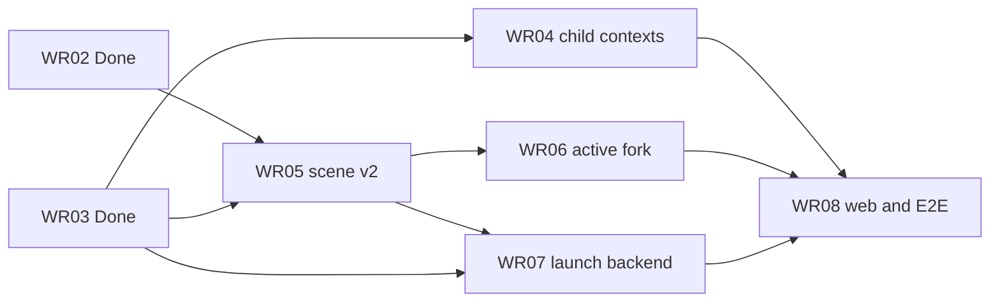

# Writer implementation | Storyteller Workshop

**Owner:** [Storyteller Workshop](UNDERTAKING.md). **Integration target:** `undertaking/storyteller-workshop` (never individual WR → `main`). **Purpose:** dependency map and planner gate, not a second work queue or permission to spend. [Global selection](../../QUEUE.md) controls default work; owner may commission a named independently ready Change. **Re-audited 2026-11-21** against source snapshot `dac6b698`, selected remote key anchors at undertaking HEAD `7fccbc6417b4959985c633a9c073571a032030ba`. These are **source-inspection observations, not runtime test passes**. Later packet-audit documentation commits advance branch HEAD without changing the inspected code.

> **Active next-wave dispatch (2026-11-21):** WR08A, WR05P1, WR07M, WR07N, and WR07L have integrated and archived. [WR05P2](../../changes/open/2026-11-21--wr05p2-v2-scene-publication/CHANGE.md) remains the open commissioned sibling for Documents v2 publication. Serialize catalog and undertaking joins. **WR07B** still has to connect the Writer final and this ledger to a durable Launch worker and first-scene authority. No old pre-MA06A WR05/WR07/WR08 packet is dispatchable.

## Finish-line execution strategy | outcome waves, not micro-refactors

**Planner decision (2026-11-21):** Drive this combined Storyteller + Modular Monolith undertaking to a **working, branchable, source-grounded Writer game on a coherent modular monolith**. The [Undertaking's completion ledger](UNDERTAKING.md#whole-undertaking-completion-control--living-ledger) remains the *only* cross-program truth tracker; this section specifies how to get there. Do not count packets, functions moved, tests added, or commits as progress. Count **integrated and demonstrated product/architecture outcomes**.

**Policy for remaining execution:** One Change can own a coherent cross-package vertical slice with **4–8 bounded Composer tasks**. We do not generate separate Change folders for moving imports, adding a schema, exposing a route, or writing each test when they are inseparable parts of one outcome. One parent owns the whole accepted Change through integration and archive. ChatGPT performs broad source investigation before handoff, then Cursor owns ordinary coding and focused proof. Prefer **one comprehensive migration** and old→new caller/export inventory over serial one-function "safe" migrations. Maintain strict care for money/permissions, SQL atomicity, source identity, no double paid dispatch and any-scene truth. Other POC cleanup may be pragmatic; do not run the entire test universe after every mechanical file move. No blank cheque for unexplained red tests.

> **Vision audit correction (2026-11-21):** [Vision-to-implementation reconciliation](VISION-TO-IMPLEMENTATION-RECONCILIATION.md) found a material gap in the earlier five-gate plan: direct Play only guarantees a **first** Writer scene, while the recurring game continuation/consequence paths still use legacy `StorytellerTask`. The selected product is a *living, repeatable Writer* that continues from player choices and accepted off-screen consequences, not simply a first-page generator. P3 now explicitly owns the **ongoing Writer/continuation contract, deliberate Workdesk canon adoption, actual provider route and independent optional research** as ONE major delivery outcome. WR07B and WR06 stay on their current conditional tracks; do not reopen them for this planning correction. A passing scripted scene-one test does NOT close P3.

### Exactly five remaining outcome gates

| Outcome (not packet count) | Concrete delivery; exit demonstration | Predecessor | Change grouping and parallel plan |
| --- | --- | --- | --- |
| **P0. Real scene checkpoints** | First and subsequent qualifying narrated scenes produce exact v2 post-state, active commitments and historical reads; v1 still works | WR05S/P1 Done | **WR05P2 Active**. Finish and integrate. **WR07N + WR07L Done**; no extra contract/ledger subpackets |
| **P1. Direct Play actually works** | Authenticated one-word/freeform prompt or pinned preset → immutable source/Writer mission → durable worker → validated scene → GA first-scene atomic commit + v2 selector → playable browser. Duplicate/lost HTTP and wake do not create second story/provider attempt | P0 + WR07N/L | **One substantial WR07B Change**, not six separate Changes. Existing source-grounded plan under planning branch `planning/wr07b-real-play-backend` (rebase/reconcile its old notes onto current source rather than copying stale T-IDs). Its acceptance is *scripted zero-provider* first, with real-model path explicitly scheduled in P3 |
| **P2. Historical scene 37 can be forked and played** | Fork while parent advanced to 80; root, notes, facts, choices, clock, offers, activities, obligations preserved as-of scene 37; child IDs remapped, no parent future/provider spend/jobs; browser inspect/fork/reentry usable | P0 only | **One substantial WR06 Change**, including focused history/fork UI and migration of active fork semantics. Can run alongside **WR07B** if source/tests/file owners are explicitly separated: fork owns `stories/forks`, fork mapper/context lineage, history UI; Launch owns `stories/initialization`, auth/worker/publisher. Shared checkpoint schema and GA seam are locked/serial, not parallel |
| **P3. Living Writer: ongoing scenes, canon, research and finite money** | Actual authorized Writer model for **opening AND later continuation/consequence scenes**, one source-rooted proposal→Game Authority publication protocol, deliberate Workdesk canon updates, distinct bounded read-only child contexts, finite shared budget, deterministic cited join, uncertainty/retry fences. Quiet work produces no unnecessary model calls. One controlled funded model run needs explicit user authorization | WR03 Done; P1 full mission route | **One broad Living Writer / WR04 delivery Change**, including continuation capture, post-choice Writer orchestration, provider transport and bounded research. Do **not** split "add child context table", "move custody function" and "wire tool list" into separate Change packets. Avoid parallel edits with WR07B to `writer-loop`, `writer-mission-custody`, `writer-workdesk` and Writer-mission schema. This lane can be *planned* now and executed after Launch's Writer seam stabilizes |
| **P4. Monorepo and integrated product finish** | Final imports/exports/graph enforce ownership, no unnecessary `@offscreen/application` compatibility façade, no package cycles or prod→lab import, app still starts; full Play/fork/Writer through 200-scene diagnostic and important crash/permission/finance checks; retire compulsory wizard and stale docs; land undertaking on `main` and retire branch/dossier | P1/P2/P3 functionality in | **One high-impact MA-final package/caller migration Change**, followed by **one integrated acceptance and landing Change** (no one-function MA06B/C/D treadmill). A final gate may uncover a real independent correctness fix; only those create extra Changes. Do not add new authority/runtime packages unless the actual source graph demands it |

**These are gates, not a claim of five exact remaining Change IDs.** P4 deliberately groups one bulk package reshaping Change plus one final integrated acceptance/landing Change. At most two genuine new Changes arise from a verified contradiction; no open-ended cleanup backlog or perfectionist polish. If the accepted objective changes, explicitly update the Undertaking ledger, not the count.

### Cross-wave sequence and capacity

```text
              WR05P2 (Active) ───┬── WR07B direct Play ──┐
                                └── WR06 active forks ──┼── final E2E acceptance
WR07N + WR07L (Done) ────────────────────┘             │
                             WR07B ── WR04+provider ───┘
                                        │
                               MA-final bulk cleanup
                                        │
                               final main landing / retirement
```

- **Now:** one Cursor owns WR05P2. Other chats that completed WR07N and WR07L do *not* need to wait idle on ceremonial review; planning may finish the next two macro packet maps while WR05P2 lands. No Cursor may start a partial WR06 based on old pre-v2 instructions. If source ownership and prerequisites support an independent present task, dispatch it with a full outcome rather than a housekeeping fragment.
- **Immediately after WR05P2 integrates:** release **WR07B + WR06** together to separate linked worktrees **only after** the planner reconciles exact v2 snapshot and writes an explicit file/resource collision map (especially `scene-checkpoint`, `stories/index`, migrations, GA/HTTP fork seam and shared SQL fixtures). If a shared output cannot be isolated, serialize *that owner*, not the entire product program.
- **As Launch settles:** launch the complete bounded child-research/provider vertical in a separate Writer owner lane, not while WR07B's Writer custody files are being edited. The third Cursor can work on the future whole-architecture migration once gameplay interfaces stop changing, but must not break active imports from under an in-flight Change.
- **At final acceptance:** no new broad projects. Make the actual E2E and module graph green, decide any leftover scope explicitly, merge the Undertaking to `main`, retire all transient branches and Design/Change dossiers per lifecycle. This is **the stop condition**.

### Architectural finish target, not package proliferation

The **actual** current workspace topology is one `@offscreen/story-engine` package that owns `stories/`, `campaign/`, `storyteller/`, `generations/`, plus pure `@offscreen/storyteller`, lower-level `@offscreen/{game,contracts,db,documents}`, `@offscreen/admin`, and `@offscreen/application` as old compatibility/composition shell. Verified current `packages/application/src/{stories,storyteller,generations,admin}/index.ts` are single-line identity forwarders. Real responsibilities remain in `application/src/drafts`, `developer-tools`, `runtime-logging`, `cache`, `outbox`. This is **not evidence that we must invent two new NPM packages or extract each module next**.

The final bulk architectural Change must source-inventory all **live external imports, barrels, app composition owners, tests and package exports** on that later HEAD, then in one coordinated migration: switch production consumers to actual owner packages, remove obsolete compatibility paths and associated dist-relative test imports, keep genuine composition/drafts/utility functionality with explicit ownership (or relocate one cohesive remaining domain if the graph proves it), enforce dependency direction at package/source level, update manifests/lockfile/TypeScript build order, and run the graph, builds and **focused** normal/negative regression suites. The dependency law is not a magic package count: game/contracts pure, story-engine source-cohesive with no dependency on application, no production→developer-tools, no user-facing authority bypass or accidental second transaction owner.

**Do not overtest every moved import:** run static grep/graph, package compile, relevant targeted tests, and a joined smoke/negative suite. Deep functional/provider regression is verified at P4 integrated acceptance once, not after every re-export deletion. Known pre-existing failures must be classified against the undertaking target; don't declare every unrelated failing old lab fixture a new blocker.

### End-state acceptance: five demonstrations

1. **One prompt, one playable story** through authenticated GA and durable Worker, with browser loss/retry and frozen Library source.
2. **100% of qualifying new scenes** have coherent as-of v2 state and source roots, with real active work and no mismatch after a failed transaction; v1 history remains readable.
3. **Historical fork after later parent progress** inherits only scene-N fictional truth, active commitments and rooted evidence, remains playable without duplicate paid operations.
4. **Writer actually keeps writing a life:** after a genuine player choice or an admitted noteworthy event it generates and publishes a new coherent scene (and later scenes), based on the exact captured branch state and rooted evidence; quiet routines run without per-tick LLM requests. Its Workdesk-selected source revisions are admitted with the scene, and optional independent research helpers remain bounded and read-only. No repeated uncertain paid attempt; a real-provider controlled demonstration is executed only with authorization.
5. **Monorepo and release are coherent:** measured graph, clean package exports, old façade retired/bounded, no new architectural regressions, reproducible local setup and relevant tests, all docs truthful, merge to `main`, remove Undertaking from active work.

The full Undertaking is **not Done** if only the packets are archived or if Play still uses a scripted response while claiming a fully operational LLM Writer. If live provider verification is unavailable, report the real limit and request explicit narrowed acceptance instead of quietly deleting it.

---
| Change | Outcome | Reality and current execution disposition |
| --- | --- | --- |
| WR02 | Persistent Library/source identity | Done, archived |
| WR03 | Writer mission and Workdesk | Done, archived; `storyteller_writer_mission` and `storyteller_writer_step` now exist |
| [WR07M](../../changes/archive/2026-11/storyteller/2026-11-21--wr07m-opening-writer-mission-scope/CHANGE.md) | Opening writer-mission scope | Done, archived; v2 opening capture pins reserved ids and does not admit a story or call a provider |
| [WR07N](../../changes/archive/2026-11/storyteller/2026-11-21--wr07n-writer-opening-scene-proposal/CHANGE.md) | Opening scene proposal | Done, archived; v2 opening finals carry passage content and do not publish or call a provider |
| [WR04](../../changes/open/2026-11-21--wr04-delegated-writer-research/CHANGE.md) | Separate bounded writer-child contexts | **PLANNER-BLOCKED:** WR03 step/custody still assumes `contextId=missionId`; read-only tool/child budget/attempt/join maps not frozen |
| [WR05](../../changes/open/2026-11-21--wr05-coherent-scene-publication/CHANGE.md) | Complete v2 scene commit + active semantic state | **PLANNER-BLOCKED:** world-state schema/after-image projector/SQL migration/note transaction design not fully decided |
| [WR06](../../changes/open/2026-11-21--wr06-fork-active-fictional-state/CHANGE.md) | Historic active-state fork | **PLANNER-BLOCKED:** needs actual WR05 v2, deterministic ID and FK remap, transactional scheduler map |
| [WR07](../../changes/open/2026-11-21--wr07-one-prompt-launch-backend/CHANGE.md) | Idempotent authenticated one-prompt Launch | **PLANNER-BLOCKED:** needs WR05 scene-one contract, the public route, and Nest+GA publication. WR07L stores the internal ledger only |
| [WR07L](../../changes/archive/2026-11/storyteller/2026-11-21--wr07l-durable-launch-ledger/CHANGE.md) | Durable Launch operation ledger | **Done** on `undertaking/storyteller-workshop`. Internal `story_launch` row and Game Authority admission. No HTTP route, no story row, and no provider call. Does not unblock WR07 |
| [WR08A](../../changes/archive/2026-11/storyteller/2026-11-21--wr08a-play-launch-surface/CHANGE.md) | Gated one-prompt Launch screen | **Done** on `undertaking/storyteller-workshop`. Web only. Flag default off until the Launch backend exists. Not integrated acceptance |
| [WR08](../../changes/open/2026-11-21--wr08-one-prompt-client-and-integrated-acceptance/CHANGE.md) | UI launch/history/fork and scripted acceptance | **PLANNER-BLOCKED:** depends on actual WR04, WR06, WR07 response and fixture contracts; current T01 is source-only, not a PATCH |

## Dependency and concurrency plan



These are **logical dependencies, not verified parallel-work permissions**. Do not automatically run WR04+WR05 simultaneously: both may edit `packages/application/src/storyteller/*`, writer publication and related migrations. Do not assume WR06+WR07 can run simultaneously: fork/Launch may share story-authority composition, API/GA seam, migration files, story selectors and disposable SQL fixtures. Before any simultaneous Change commissions, **ChatGPT** must publish exact files/resources/exports and a verified disjointness matrix; one integration custodian serializes merges. Within one ready packet allow up to two truly independent Composer workers only when the packet proves no source/generated output/fixture/Git collisions. Otherwise serial is preferable.

## Planner's next bounded work, not paid Cursor work

1. **WR04:** specify context-qualified writer step/custody signatures, child budget SQL and tool enforcement; write exact T-ID maps and focused negative tests, then independent G0–G7.
2. **WR05:** freeze canonical v2 schema/size policy, after-state transition table, SQL version migration and pre-stage/lock/adopt proof; split if necessary and independently audit.
3. **WR06 and WR07:** after WR05 is integrated, map exact v2 ID remap vs Launch scene-one/custody and test fixtures. Independently inspect concurrency and update each Change.
4. **WR08:** only after backend contracts are landed, select precise UI hooks/routes and existing harness; isolate functional zero-provider acceptance from optional funded creative quality.

The `SOURCE-MAP.md` and `PROOF.md` for each Change include its initial G0–G7 audit and observed failure modes. WR08A is the commissioned web Launch surface and is Done; it does not publish a backend or claim integrated Play. All current WR04–WR08 T-IDs are explicitly **PLANNER-BLOCKED**, so “do WR04” must not cause a Cursor design expedition. ChatGPT prepares/re-audits the specific next packet first. After a packet passes and the owner commissions it, Cursor completes that **whole Change** through verified proof, reconciliation, squash integration, archive and clean worktree retirement without automatic successor dispatch.

**Historical provenance, not active instructions:** [original implementation program](https://github.com/DenisSkulovic/offscreen-rpg/blob/4ee459b9acdc73c7f63674b697baeb9c7e685da4/work/changes/WRITER-IMPLEMENTATION-2026-11-21.md), [documentation handoff](https://github.com/DenisSkulovic/offscreen-rpg/blob/4ee459b9acdc73c7f63674b697baeb9c7e685da4/work/changes/WRITER-DOCS-CHATGPT-HANDOFF-2026-11-21.md), and [old Composer audit](https://github.com/DenisSkulovic/offscreen-rpg/blob/4ee459b9acdc73c7f63674b697baeb9c7e685da4/work/changes/WR-COMPOSER-HANDOFF-AUDIT-2026-11-21.md). These do not supersede current code or current readiness.

**Exit:** only after the undertaking's actual implementation/evidence and canonical documents are reconciled, use its integration and retirement procedure; never mistake planning completion for proof.
