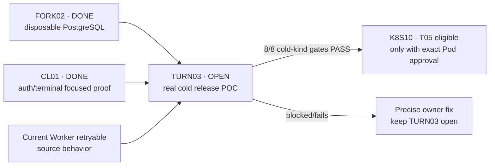

# Release-proof backlog audit | FORK02 · CL01 · TURN03 · K8S10

**2026-11-23 · inspected `undertaking/storyteller-workshop@ade6cfbf` via GitHub.** This is a source/document evidence audit, **not a local test or cluster run**. Local worktree dirtiness, leases, cluster state and credential readiness were not inspected. HR03 and DXK10-A are separately executing on disjoint paths.

## Closure scoreboard

| Change | Packet lifecycle | Integrated source and lower-tier evidence | Still missing | Action |
| --- | --- | --- | --- | --- |
| [FORK02](../../changes/archive/2026-11/data/2026-11-22--fork02-v2-checkpoint-roundtrip-fidelity/CHANGE.md) | **DONE / archived** | Real disposable PostgreSQL JSONB null distinction; 38 focused integration and 4 fork-state tests passed, complete v2 fictional-field collector (per Change receipt) | No live release-kind as-of historical fork; TURN03 owns it | **Keep archived.** Do not reimplement v2 mapping without a new failure |
| [CL01](../../changes/archive/2026-11/experience/2026-11-22--cl01-terminal-player-client/CHANGE.md) | **DONE / archived** | Terminal client, story-only bearer, one-time browser-consent protocol, migration 0024; reported terminal 24/24, Web connect 2/2, disposable auth 15/15 | Actual browser click-through and full release-stack play NOT RUN | **Keep archived.** Record live browser/auth evidence under TURN03 or explicit follow-up, not as a retroactive CL01 pass |
| [TURN03](../../changes/open/2026-11-19--turn03-full-distributed-forkable-turn-proof/CHANGE.md) | **OPEN / blocked** | Fixture 4/4 and local causal 5/5; release-lab scripted start and scene1 previously reached | Actual scene2 publication, SSE/GET, historical fork, negative/recovery matrix; all eight cold-kind gates | **Finish real cross-Pod runner before repeating expensive release proof.** Preserve failed 2026-11-22 receipt |
| [K8S10](../../changes/open/2026-11-19--k8s10-distributed-fault-and-load-harness/CHANGE.md) | **OPEN / live gate held** | T01–T04 pure adapters, guarded one-pod delete controller, oracle and bounded load report source exist; earlier selector/oracle 43/43 unit tests reported | Current-HEAD full focused suite, real eligible baseline, single explicitly approved disposable-lab Pod delete and recovery oracle | **No live deletion** before a genuine TURN03 PASS plus exact human authorization |

## Important correction to TURN03's historical blocker

The 2026-11-22 release run observed a `pending-consequence-not-settled` publication failure while the action execution was still `running`; the non-retryable activity failed, and no published scene 2 followed. At inspected current HEAD, `apps/worker/src/activities/storyteller-distributed-control.ts::publishSavedStoryteller` maps that exact blocked reason to **`ApplicationFailure.retryable(..., 'PublicationPendingSettlement')`**, and `packages/story-engine/src/campaign/narrative-intent-settlement.ts::settleNarrativeIntentExecution` calls `scheduleWriterContinuation` after settlement. This makes the original non-retryable failure **potentially fixed in source**. It does **not** prove the real `writer.scene.v1` wake, release image freshness, scene2 or fork in a running cluster.

The checked-in `infra/verification/release-acceptance/turn03/run.mjs::runTurn03ColdTrace` currently uses an **injected `http` adapter**, generic simulated routes such as `POST /stories`, `POST /game-authority/scenes/2/commit`, and `mockGateEvidence` with `tier:'local', mocked:true, incomplete:true`. Its final gate loop marks all genuine cross-Pod gates `NOT-RUN` (or historical fork `FAIL` when mock fields are absent). `preflight.mjs` returns `runAllowed:false`; the directory has no integrated standalone live operator CLI. The runner is valuable as report-schema and refusal testing but **cannot currently award TURN03 all-eight-gate PASS**.

**2026-11-23 subsequent source inspection:** the integrated local multiprocess test provides the actual public API methods, payloads, and scene1/scene2 SQL expectations. [TURN03 source-exact route map](../../changes/open/2026-11-19--turn03-full-distributed-forkable-turn-proof/SOURCE-ROUTE-MAP-2026-11-23.md) and [staged execution](../../changes/open/2026-11-19--turn03-full-distributed-forkable-turn-proof/NEXT-EXECUTION-2026-11-23.md) split a source-only R1 route correction from the still-unsettled authenticated live operator R2. Source-only TURN03/report planning tests: 20/20 PASS on uploaded `a755b183` snapshot. No live tests or new cluster preflight run.

## Efficient next execution

1. **Source-only TURN03 runner completion**, in the existing TURN03 Change: review current `infra/kubernetes/lab/app-release/turn03/{preflight,run,report}.mjs`, `tools/api-integration/test/helpers/turn03-distributed-poc-fixture.ts`, real public API/GA routes and app-release launcher. Make one real authenticated operator-controlled release runner consuming actual HTTP+S3+SQL+Temporal evidence; do not invoke in-process game methods as purported Pod evidence. Preserve current mocked report tests as lower-tier. This is **not** permission for a full cluster run or new package/Change.
2. One **read-only** `kind-offscreen-lab` preflight and host resource check after source/integration changes settle; ensure single cluster operator, unmodified other worktrees, no secrets printed, exact release image/source digests and honest OAuth availability. No rebuild or `install.sh` merely to diagnose prerequisites.
3. If runner and prerequisites pass, **one** explicitly operator-authorized disposable-lab scripted acceptance, with nonpaid execution; capture all eight gates and negative matrix. A missing gate remains blocked, not partially archived. First failure returns its exact owner (Writer settlement, GA, API, S3, release manifest) for one bounded correction and focused regression.
4. Only after TURN03 **overall PASS**: K8S10 read-only eligibility/plan, then a separately approved Pod UID/runId-specific graceful delete and oracle. Don't conflate K8S10's 43 pure tests with a live-chaos PASS.

## Scope/concurrency

Do not modify HR03 `packages/db/**` or DXK10-A `scripts/repo-tools/dev-*`; leave primary dirty changes intact. A TURN03 runner implementation can be a third source-only Cursor lane **if separately commissioned**, but no paid agent needs to launch a six-role dev cluster or replace release-lab workloads for the runner alone. Observe one exclusive lab writer for the eventual live proof.

**Disposition:** no concealed finished code is discarded; FORK02/CL01 remain legitimately archived, TURN03/K8S10 remain openly incomplete and separately test-gated. This audit did not run tests or exercise Kubernetes.
